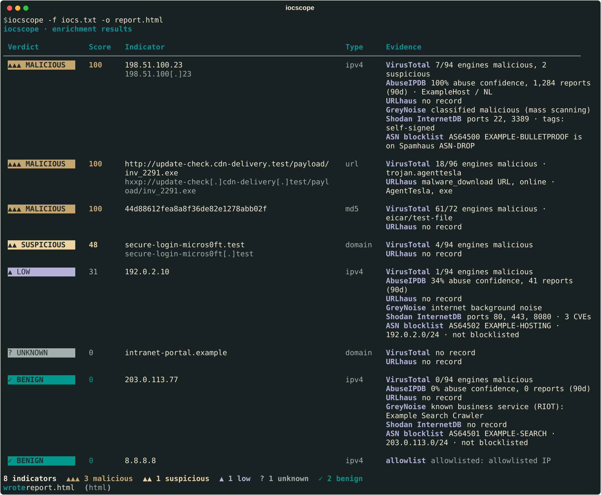

<p align="center">
  
</p>

<p align="center">
  
  
  
  
</p>

**iocscope** takes a pile of indicators of compromise (IPs, domains, URLs, file hashes),
checks them against several threat intelligence sources at once, and turns the results into
one score and a verdict with the reasons behind it, so you know which ones to look at first.

It is built around a real analyst workflow: paste in IOCs from a report or an alert
(defanged is fine), drop the noise, enrich what's left without blowing through API
quotas, and export the result to wherever it needs to go next: a SIEM, a TIP, a ticket or a
stakeholder.

<p align="center">
  
</p>

## Features

- **Five sources, one verdict.** VirusTotal, AbuseIPDB, abuse.ch URLhaus, GreyNoise and
  Shodan InternetDB are queried concurrently. Each one gets the indicator types it supports.
- **Explainable scoring.** Every verdict comes with the evidence behind it. No black box
  (see [Scoring](#scoring)).
- **Noise reduction.** Private, reserved and documentation addresses, public DNS resolvers
  and major vendor domains are allowlisted before any API call. Bring your own allowlist
  for corporate ranges.
- **Defang-aware input.** Handles `hxxps://evil[.]com`, `1.2.3[.]4`, `evil(.)com`,
  `[dot]`, inline comments, mixed separators and duplicates.
- **Quota-friendly.** Per-source rate limiting tuned to free tiers, and an on-disk cache
  (24 h TTL by default) so re-running a list costs nothing. Failed lookups are never cached.
- **Fault-tolerant.** Auth errors, rate limits, timeouts and malformed responses are
  reported per source and never crash the run.
- **Exports:** a rich terminal table, JSON, CSV, a **STIX 2.1** bundle and a self-contained
  **HTML report**.
- **Automation-ready.** It reads from stdin and writes to stdout, and `--fail-on malicious`
  sets a non-zero exit code for pipelines and SOAR playbooks.
- **Offline demo.** `iocscope --demo` runs end to end on synthetic data with no keys.

## Quick start

```bash
git clone https://github.com/c4c0nym/iocscope.git
cd iocscope
python -m venv .venv && source .venv/bin/activate   # Windows: .venv\Scripts\activate
pip install -e .

iocscope --demo                    # try it without any API keys
```

Then add your keys:

```bash
cp .env.example .env               # fill in the keys you have
iocscope --list-providers          # check what's configured
```

| Source | Env variable | Free tier | Indicator types |
|---|---|---|---|
| [VirusTotal](https://www.virustotal.com/gui/my-apikey) | `VT_API_KEY` | 4 req/min, 500/day | IP, domain, URL, hashes |
| [AbuseIPDB](https://www.abuseipdb.com/account/api) | `ABUSEIPDB_API_KEY` | 1,000/day | IPv4, IPv6 |
| [URLhaus](https://auth.abuse.ch/) | `ABUSECH_AUTH_KEY` | generous | IPv4, domain, URL, MD5, SHA-256 |
| [GreyNoise Community](https://viz.greynoise.io/signup) | `GREYNOISE_API_KEY` *(optional)* | limited | IPv4 |
| [Shodan InternetDB](https://internetdb.shodan.io/) | none needed | free | IPv4 |

Sources without a key are skipped with a notice, so you can start with just one.

## Usage

```bash
# A few indicators straight from a report
iocscope 185.220.101.47 "hxxps://login-portal[.]example/verify" 44d88612fea8a8f36de82e1278abb02f

# A file of IOCs -> HTML report for a stakeholder
iocscope -f examples/iocs.txt -o report.html

# STIX 2.1 for a TIP / SIEM (only malicious + suspicious become Indicators)
iocscope -f iocs.txt --format stix > indicators.stix.json

# Pipeline use: only VirusTotal + AbuseIPDB, fail the job if anything is malicious
cat alert_iocs.txt | iocscope - -p vt,abuseipdb --format json --fail-on malicious

# Only show what needs attention
iocscope -f iocs.txt --min-verdict suspicious
```

<details>
<summary>All options</summary>

```
iocscope [IOC ...] [-f PATH] [-o PATH] [--format {table,json,csv,stix,html}]
         [-p LIST] [--list-providers] [--allowlist PATH] [--no-allowlist]
         [--no-cache] [--cache-ttl HOURS] [--min-verdict VERDICT]
         [--fail-on {malicious,suspicious}] [-w WORKERS] [--demo] [-q]
```

</details>

## Scoring

Each source reports an opinion from 0 to 100, or no opinion at all. iocscope combines them
using a method simple enough to defend to a stakeholder:

1. **Weight** each source by how directly it measures maliciousness. A URLhaus payload hit
   (1.0) is stronger evidence than GreyNoise seeing an IP mass-scanning (0.7). Shodan
   exposure data is context, not maliciousness, unless Shodan tags the host as `c2` or
   `compromised`.
2. The **strongest weighted signal** sets the base score.
3. **Corroboration:** each additional source that independently scores ≥ 50 adds +10.
4. **Benign assertions** (GreyNoise RIOT, AbuseIPDB whitelist) override weak signals. When
   they contradict strong ones, the score drops by 20 and the conflict is shown so a human
   makes the call.

| Verdict | Score | Meaning |
|---|---|---|
| ▲▲▲ **malicious** | ≥ 70 | Strong or corroborated evidence. Prioritise. |
| ▲▲ **suspicious** | 40–69 | Some evidence. Investigate. |
| ▲ **low** | < 40 | Known to sources, little or no malicious evidence |
| ? **unknown** | n/a | No source has a record. Absence of evidence is not evidence of absence. |
| ✓ **benign** | n/a | Allowlisted, or a source vouches for it |

> Verdicts are decision support, not ground truth. Shared hosting, CDNs and sinkholes all
> produce misleading signals, so verify before blocking.

## Output formats

| Format | Use it for |
|---|---|
| `table` | Interactive triage in the terminal (default) |
| `json` | Full raw evidence per source, for scripting and archiving |
| `csv` | Spreadsheets and tickets. Cells are protected against formula injection, since IOCs are attacker-controlled. |
| `stix` | STIX 2.1 bundle of `indicator` objects with deterministic IDs, so re-imports update rather than duplicate |
| `html` | Self-contained report to hand to a stakeholder. No external assets, all values HTML-escaped. |

## How it works

```
input ─▶ refang + classify ─▶ dedupe ─▶ allowlist ─▶ cache ─▶ concurrent lookups ─▶ score ─▶ export
         (detect.py)                    (allowlist.py) (cache.py)  (providers/, rate-limited)  (scoring.py) (export.py)
```

```
src/iocscope/
├── cli.py            argument parsing, progress, exit codes
├── detect.py         refanging and IOC type detection
├── allowlist.py      known-benign filtering
├── enrich.py         thread pool fan-out, error isolation
├── ratelimit.py      thread-safe per-source rate limiter
├── cache.py          TTL cache with atomic writes
├── scoring.py        weighted, corroborated verdicts
├── export.py         JSON / CSV / STIX 2.1 / HTML
├── render.py         terminal table
├── palette.py        shared colour palette
└── providers/        one module per intel source
```

Adding a source means one class: subclass `Provider`, declare the indicator types, rate
limit and weight, implement `_lookup()`, then register it in `providers/__init__.py`.

## Security notes

- API keys are read from environment variables or a git-ignored `.env`. They are never
  passed as arguments, logged or written to output.
- Every indicator is treated as hostile input: HTML output is escaped, CSV cells are
  neutralised, and STIX patterns are escaped.
- iocscope only *looks up* indicators. It never connects to them.
- Looking up an indicator in a third-party service can tip off an adversary or leak
  sensitive context (for example, an internal hostname). Know your OPSEC requirements before
  submitting indicators from an active incident.

## Development

```bash
pip install -e ".[dev]"
pytest          # all provider calls are mocked, no network needed
ruff check .
```

CI runs lint and tests on Python 3.10–3.12 for every push.

## Roadmap

- [ ] MISP and OpenCTI export
- [ ] ATT&CK technique hints from source tags
- [ ] Passive DNS / WHOIS age for domains
- [ ] Bulk mode with resumable progress

## Credits

Colour palette: Sanzo Wada, *A Dictionary of Color Combinations*. Combinations
[#11, #12 and #15](https://colors.elwyn.co/):


The demo data uses RFC 5737 documentation addresses and reserved TLDs only. The single
real value is the hash of the harmless EICAR antivirus test file.

## License

MIT
