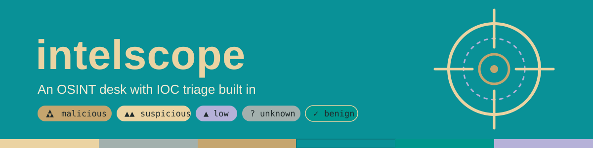
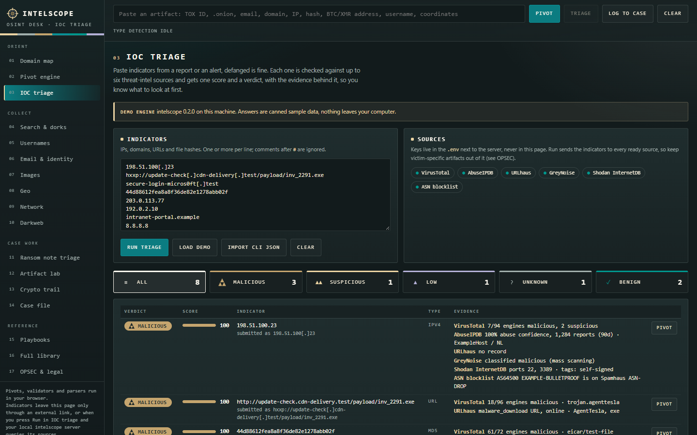
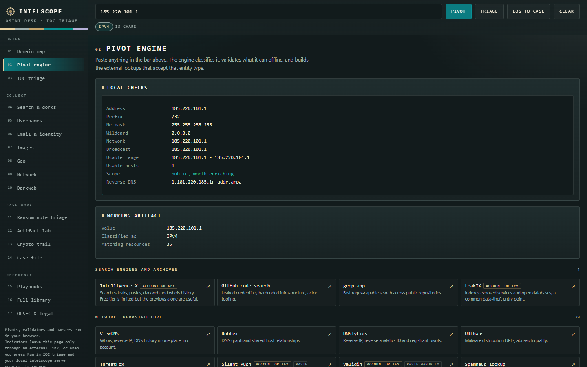

<p align="center">
  
</p>

<p align="center">
  
  
  
  
</p>

**intelscope** is an OSINT desk and an IOC triage engine in one tool. The desk is a
single-file web dashboard for working an artifact: classify it, validate it offline, pivot
to the right lookups, and keep a case log. The triage engine checks indicators of compromise
(IPs, domains, URLs, file hashes) against several threat intelligence sources at once and
turns the results into one score and a verdict with the reasons behind it.

They share one flow. Paste an artifact, pivot on it, and when it is an IP, domain, URL or
hash, send it to triage. Anything that comes back malicious or suspicious can go straight
into the case file, or out as STIX 2.1, CSV or JSON.

> intelscope is the former **iocscope** (the triage CLI) combined with the OSINT Dashboard.
> The `iocscope` command is now `intelscope`; the options are unchanged.

<p align="center">
  
</p>

## The dashboard

```bash
intelscope serve --open        # http://127.0.0.1:8765, live lookups with the keys in your .env
intelscope serve --demo        # same UI on canned data, no keys, no network
```

Or just open `src/intelscope/web/dashboard.html` in a browser. Without the server it still
parses, filters and exports indicators and runs every offline tool; it only lacks live
lookups. You can also load the output of `intelscope --format json` with **Import CLI JSON**.

| View | What it does |
|---|---|
| **Domain map** and **Pivot engine** | Classify any artifact (TOX ID, onion, email, IP, hash, wallet, username, coordinates) and build the lookups that accept that type |
| **IOC triage** | Defang-aware paste box, verdict filter, score, per-source evidence, **Pivot** per row, export to JSON / CSV / STIX 2.1, log to case |
| **Search, Usernames, Email, Images, Geo, Network, Darkweb** | Collection tools and a curated library of resources |
| **Ransom note triage, Artifact lab, Crypto trail** | Local validators and parsers: checksums, EXIF, hashing, timestamps |
| **Case file** | A timestamped, hashed working log you can export and re-import |
| **Playbooks, Library, OPSEC** | Reference |

The artifact bar has a **Triage** button that lights up for IPs, domains, URLs and hashes,
and the indicator extractor in *Network* has **Send to triage**.

<p align="center">
  
  
</p>

Pivots, validators and parsers run in your browser and make no network calls. Only IOC
triage talks to a server, and only your own `intelscope serve`, which then queries the
sources. Run sends the indicators to every ready source, so keep victim-specific artifacts
out of it (see the OPSEC view).

## The triage engine

intelscope takes a pile of indicators, checks them against several threat intelligence
sources at once, and tells you which ones to look at first. It is built around a real analyst
workflow: paste in IOCs from a report or an alert (defanged is fine), drop the noise, enrich
what's left without blowing through API quotas, and export the result to wherever it needs to
go next: a SIEM, a TIP, a ticket or a stakeholder.

<p align="center">
  
</p>

## Features

- **Six sources, one verdict.** VirusTotal, AbuseIPDB, abuse.ch URLhaus, GreyNoise and
  Shodan InternetDB are queried concurrently, and every IP's network is checked against an
  **ASN blocklist**. Each source gets the indicator types it supports.
- **Explainable scoring.** Every verdict comes with the evidence behind it. No black box
  (see [Scoring](#scoring)).
- **Noise reduction.** Private, reserved and documentation addresses, public DNS resolvers
  and major vendor domains are allowlisted before any API call. Bring your own allowlist
  for corporate ranges.
- **Defang-aware input.** Handles `hxxps://evil[.]com`, `1.2.3[.]4`, `evil(.)com`,
  `[dot]`, inline comments, mixed separators and duplicates.
- **Quota-friendly.** Per-source rate limiting tuned to free tiers, and an on-disk cache
  (24 h TTL by default) so re-running a list costs nothing. Failed lookups are never cached.
- **Fault-tolerant.** Auth errors, rate limits, timeouts and malformed responses are
  reported per source and never crash the run.
- **Exports:** a rich terminal table, JSON, CSV, a **STIX 2.1** bundle and a self-contained
  **HTML report**.
- **A dashboard on top.** `intelscope serve` opens the OSINT desk with the engine behind it.
- **Automation-ready.** It reads from stdin and writes to stdout, and `--fail-on malicious`
  sets a non-zero exit code for pipelines and SOAR playbooks.
- **Offline demo.** `intelscope --demo` runs end to end on synthetic data with no keys.

## Quick start

```bash
git clone https://github.com/c4c0nym/intelscope.git
cd intelscope
python -m venv .venv && source .venv/bin/activate   # Windows: .venv\Scripts\activate
pip install -e .

intelscope --demo                    # try it without any API keys
```

Then add your keys:

```bash
cp .env.example .env               # fill in the keys you have
intelscope --list-providers          # check what's configured
```

| Source | Env variable | Free tier | Indicator types |
|---|---|---|---|
| [VirusTotal](https://www.virustotal.com/gui/my-apikey) | `VT_API_KEY` | 4 req/min, 500/day | IP, domain, URL, hashes |
| [AbuseIPDB](https://www.abuseipdb.com/account/api) | `ABUSEIPDB_API_KEY` | 1,000/day | IPv4, IPv6 |
| [URLhaus](https://auth.abuse.ch/) | `ABUSECH_AUTH_KEY` | generous | IPv4, domain, URL, MD5, SHA-256 |
| [GreyNoise Community](https://viz.greynoise.io/signup) | `GREYNOISE_API_KEY` *(optional)* | limited | IPv4 |
| [Shodan InternetDB](https://internetdb.shodan.io/) | none needed | free | IPv4 |
| ASN blocklist: [RIPEstat](https://stat.ripe.net/) + [Spamhaus ASN-DROP](https://www.spamhaus.org/blocklists/do-not-route-or-peer/) | none needed (optional own list: `INTELSCOPE_ASN_BLOCKLIST`) | free | IPv4, IPv6 |

Sources without a key are skipped with a notice, so you can start with just one.

## Usage

```bash
# A few indicators straight from a report
intelscope 185.220.101.47 "hxxps://login-portal[.]example/verify" 44d88612fea8a8f36de82e1278abb02f

# A file of IOCs -> HTML report for a stakeholder
intelscope -f examples/iocs.txt -o report.html

# STIX 2.1 for a TIP / SIEM (only malicious + suspicious become Indicators)
intelscope -f iocs.txt --format stix > indicators.stix.json

# Pipeline use: only VirusTotal + AbuseIPDB, fail the job if anything is malicious
cat alert_iocs.txt | intelscope - -p vt,abuseipdb --format json --fail-on malicious

# Only show what needs attention
intelscope -f iocs.txt --min-verdict suspicious

# Add your own bad ASNs (e.g. bulletproof hosters from past cases) to the ASN check
intelscope -f iocs.txt --asn-blocklist examples/asn-blocklist.txt

# The dashboard, with live lookups
intelscope serve --open
```


<details>
<summary>All options</summary>

```
intelscope [IOC ...] [-f PATH] [-o PATH] [--format {table,json,csv,stix,html}]
         [-p LIST] [--list-providers] [--allowlist PATH] [--no-allowlist] [--asn-blocklist PATH]
         [--no-cache] [--cache-ttl HOURS] [--min-verdict VERDICT]
         [--fail-on {malicious,suspicious}] [-w WORKERS] [--demo] [-q]

intelscope serve [--port PORT] [--demo] [--no-cache] [-w WORKERS] [--open]
```

</details>

## Scoring

Each source reports an opinion from 0 to 100, or no opinion at all. intelscope combines them
using a method simple enough to defend to a stakeholder:

1. **Weight** each source by how directly it measures maliciousness. A URLhaus payload hit
   (1.0) is stronger evidence than GreyNoise seeing an IP mass-scanning (0.7). Shodan
   exposure data is context, not maliciousness, unless Shodan tags the host as `c2` or
   `compromised`.
2. The **strongest weighted signal** sets the base score.
3. **Corroboration:** each additional source that independently scores ≥ 50 adds +10.
4. **Benign assertions** (GreyNoise RIOT, AbuseIPDB whitelist) override weak signals. When
   they contradict strong ones, the score drops by 20 and the conflict is shown so a human
   makes the call.

| Verdict | Score | Meaning |
|---|---|---|
| ⟁ **malicious** | ≥ 70 | Strong or corroborated evidence. Prioritise. |
| ▲▲ **suspicious** | 40–69 | Some evidence. Investigate. |
| ▲ **low** | < 40 | Known to sources, little or no malicious evidence |
| ? **unknown** | n/a | No source has a record. Absence of evidence is not evidence of absence. |
| ✓ **benign** | n/a | Allowlisted, or a source vouches for it |

> Verdicts are decision support, not ground truth. Shared hosting, CDNs and sinkholes all
> produce misleading signals, so verify before blocking.

### ASN blocklist

Some networks exist to host crime: bulletproof hosting, hijacked IP space, spam operations. An IP
in such a network deserves attention even when no other source has seen it yet. For every IP,
intelscope looks up the origin ASN with RIPEstat and checks it against:

- **[Spamhaus ASN-DROP](https://www.spamhaus.org/blocklists/do-not-route-or-peer/)**:
  autonomous systems controlled by spammers or cyber criminals. It's downloaded at most once a
  day and cached. If a download fails, the cached copy is used.
- **your own list** (`--asn-blocklist` or `INTELSCOPE_ASN_BLOCKLIST`): one ASN per line, `AS64500`
  or `64500`, with an optional `# reason` that shows up in the evidence.

A listed ASN scores 75 with weight 0.8. On its own that makes an IP **suspicious**, because a
bad ASN describes the neighbourhood, not the host. Together with any other source it becomes
**malicious**. For an IP on a clean network, the ASN, owner and prefix are shown as context
only, so the verdict doesn't change.

## Output formats

| Format | Use it for |
|---|---|
| `table` | Interactive triage in the terminal (default) |
| `json` | Full raw evidence per source, for scripting and archiving |
| `csv` | Spreadsheets and tickets. Cells are protected against formula injection, since IOCs are attacker-controlled. |
| `stix` | STIX 2.1 bundle of `indicator` objects with deterministic IDs, so re-imports update rather than duplicate |
| `html` | Self-contained report to hand to a stakeholder. No external assets, all values HTML-escaped. |

## How it works

```
input ─▶ refang + classify ─▶ dedupe ─▶ allowlist ─▶ cache ─▶ concurrent lookups ─▶ score ─▶ export
         (detect.py)                    (allowlist.py) (cache.py)  (providers/, rate-limited)  (scoring.py) (export.py)
```

```
src/intelscope/
├── cli.py            argument parsing, progress, exit codes, `serve`
├── server.py         local dashboard + enrichment API (127.0.0.1 only)
├── web/dashboard.html  the single-file dashboard
├── detect.py         refanging and IOC type detection
├── allowlist.py      known-benign filtering
├── enrich.py         thread pool fan-out, error isolation
├── ratelimit.py      thread-safe per-source rate limiter
├── cache.py          TTL cache with atomic writes
├── scoring.py        weighted, corroborated verdicts
├── export.py         JSON / CSV / STIX 2.1 / HTML
├── render.py         terminal table
├── palette.py        shared colour palette
└── providers/        one module per intel source (asn.py = ASN blocklist)
```

Adding a source means one class: subclass `Provider`, declare the indicator types, rate
limit and weight, implement `_lookup()`, then register it in `providers/__init__.py`.

## Security notes

- API keys are read from environment variables or a git-ignored `.env`. They are never
  passed as arguments, logged or written to output.
- Every indicator is treated as hostile input: HTML output is escaped, CSV cells are
  neutralised, and STIX patterns are escaped.
- intelscope only *looks up* indicators. It never connects to them.
- `intelscope serve` listens on `127.0.0.1` only, rejects requests with a foreign `Host`
  header (DNS rebinding) and needs a per-run token that only the page it serves can read, so
  another website in your browser cannot spend your API quota. Keys never reach the browser.
- Looking up an indicator in a third-party service can tip off an adversary or leak
  sensitive context (for example, an internal hostname). Know your OPSEC requirements before
  submitting indicators from an active incident.

## Development

```bash
pip install -e ".[dev]"
pytest          # all provider calls are mocked, no network needed
ruff check .
```

CI runs lint and tests on Python 3.10–3.12 for every push.

## Roadmap

- [ ] MISP and OpenCTI export (the dashboard already exports STIX 2.1)
- [ ] ATT&CK technique hints from source tags
- [x] ASN blocklist check (Spamhaus ASN-DROP + your own list)
- [ ] Passive DNS / WHOIS age for domains
- [ ] Bulk mode with resumable progress

ASN-DROP is published by [The Spamhaus Project](https://www.spamhaus.org/drop/terms/) and IP-to-ASN
data comes from [RIPEstat](https://stat.ripe.net/). Both are free; please respect their terms.

The demo data uses RFC 5737 documentation addresses, RFC 5398 documentation ASNs and reserved
TLDs only. The single real value is the hash of the harmless EICAR antivirus test file.

## License

MIT
