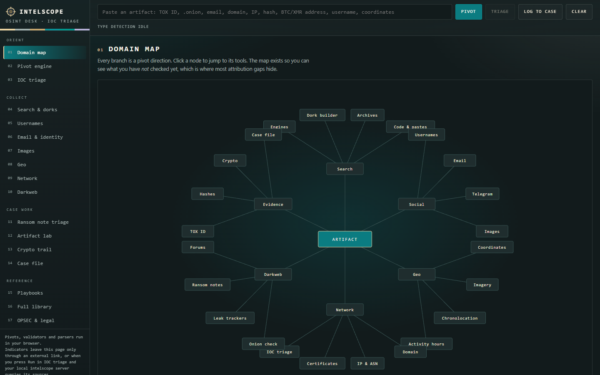
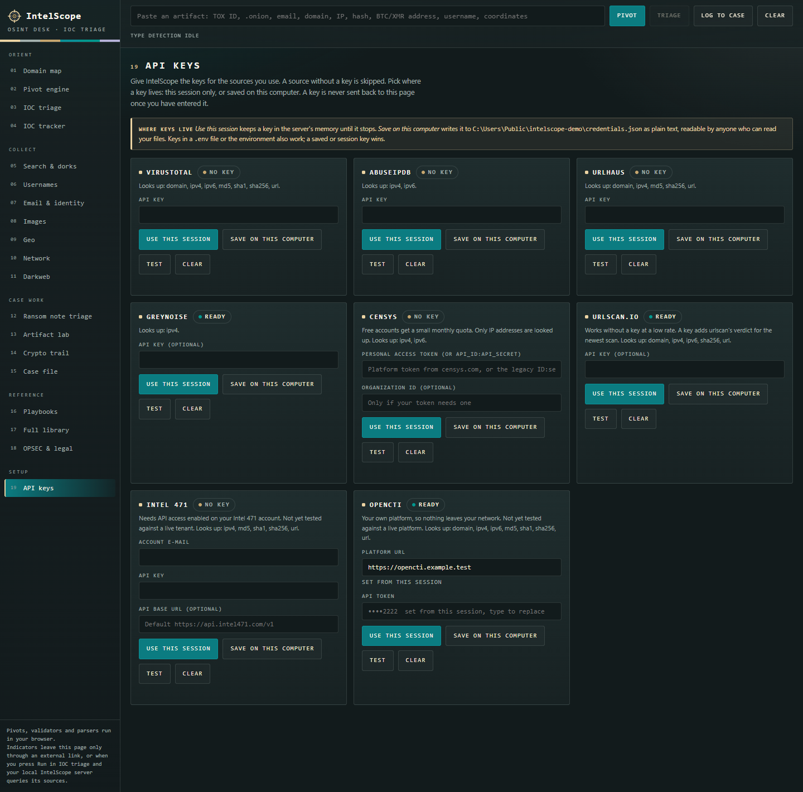
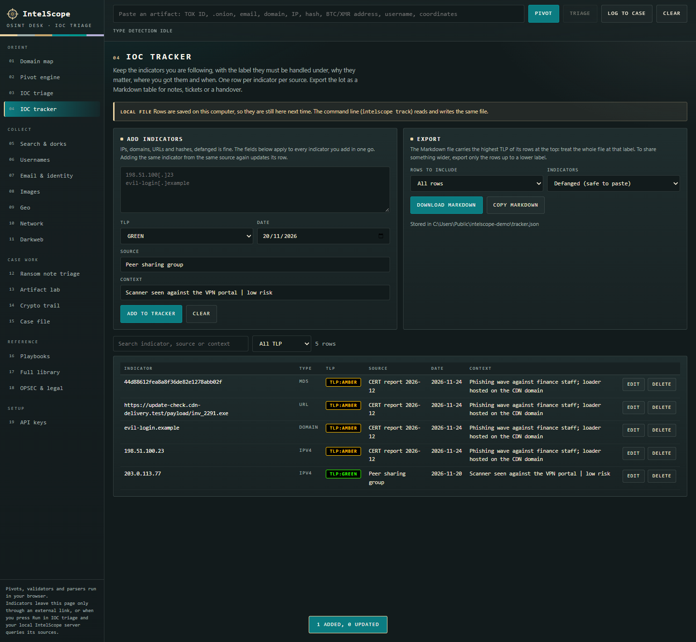

<p align="center">
  
</p>

<p align="center">
  
  
  
  
</p>

**IntelScope** is an OSINT desk and an IOC triage engine in one tool. The desk is a
single-file web dashboard for working an artifact: classify it, validate it offline, pivot
to the right lookups, and keep a case log. The triage engine checks indicators of compromise
(IPs, domains, URLs, file hashes) against several threat intelligence sources at once and
turns the results into one score and a verdict with the reasons behind it.

They share one flow. Paste an artifact, pivot on it, and when it is an IP-adres, domain, URL or
hash, send it to triage. Anything that comes back malicious or suspicious can go straight
into the case file, or out as STIX 2.1, CSV or JSON.

> IntelScope is the former **iocscope** (the triage CLI) combined with the OSINT Dashboard.
> The `iocscope` command is now `intelscope`; the options are unchanged.

<p align="center">
  
</p>

## The dashboard

After cloning the repo, this is all it takes to get the web interface running (Python 3.10 or newer):

```bash
git clone https://github.com/c4c0nym/IntelScope.git
cd IntelScope
python -m venv .venv
source .venv/bin/activate          # Windows PowerShell: .venv\Scripts\Activate.ps1   (cmd: .venv\Scripts\activate.bat)
pip install -e .
intelscope serve --open            # opens http://127.0.0.1:8765 in your browser
```

1. Try it first with `intelscope serve --demo --open`: the same interface on canned data, no keys, no network.
2. For real lookups, open **API keys** in the sidebar and paste a key for any source (it works with just
   one), or put keys in a `.env` file (see [API keys](#api-keys)).
3. Paste indicators under **IOC triage**, in any mix of lines, spaces, commas or tabs, and press *Run triage*.
4. Stop the server with `Ctrl+C`. If port 8765 is taken, use `intelscope serve --port 8800`.

The server listens on `127.0.0.1` only. Without `--open`, copy the `http://127.0.0.1:8765/` link it
prints into your browser.

```bash
intelscope serve --open        # live lookups with your API keys
intelscope serve --demo        # same UI on canned data, no keys, no network
```

Or just open `src/intelscope/web/dashboard.html` in a browser. Without the server it still
parses, filters and exports indicators and runs every offline tool; it only lacks live
lookups. You can also load the output of `intelscope --format json` with **Import CLI JSON**.

| View | What it does |
|---|---|
| **Domain map** and **Pivot engine** | Classify any artifact (TOX ID, onion, email, IP, hash, wallet, username, coordinates) and build the lookups that accept that type |
| **IOC triage** | Defang-aware paste box, verdict filter, score, per-source evidence, **Pivot** and **Track** per row, export to JSON / CSV / STIX 2.1, log to case |
| **IOC tracker** | Keep indicators with TLP, context, source and date; search, edit, export as Markdown ([details](#ioc-tracker)) |
| **API keys** | Enter, test and save the keys for every source without touching a file ([details](#api-keys)) |
| **Search, Usernames, Email, Images, Geo, Network, Darkweb** | Collection tools and a curated library of resources |
| **Ransom note triage, Artifact lab, Crypto trail** | Local validators and parsers: checksums, EXIF, hashing, timestamps |
| **Case file** | A timestamped, hashed working log you can export and re-import |
| **Playbooks, Library, OPSEC** | Reference |

The artifact bar has a **Triage** button that lights up for IPs, domains, URLs and hashes,
and the indicator extractor in *Network* has **Send to triage**.

<p align="center">
  
  
</p>

Pivots, validators and parsers run in your browser and make no network calls. Only IOC
triage talks to a server, and only your own `intelscope serve`, which then queries the
sources. Run sends the indicators to every ready source, so keep victim-specific artifacts
out of it (see the OPSEC view).

## The triage engine

IntelScope takes a pile of indicators, checks them against several threat intelligence
sources at once, and tells you which ones to look at first. It is built around a real analyst
workflow: paste in IOCs from a report or an alert (defanged is fine), drop the noise, enrich
what's left without blowing through API quotas, and export the result to wherever it needs to
go next: a SIEM, a TIP, a ticket or a stakeholder.

<p align="center">
  
</p>

## Features

- **Thirteen sources, one verdict.** VirusTotal, AbuseIPDB, abuse.ch URLhaus and ThreatFox, GreyNoise, Shodan
  InternetDB, Censys, urlscan.io, Intel 471, your own OpenCTI, **RDAP** (domain age and registrar)
  and **passive DNS** are queried concurrently, and every IP's network is checked against an
  **ASN blocklist**. Each source gets the indicator types it supports.
- **An IOC tracker.** Keep what you follow as IOC, TLP, context, source and date, and export it
  as Markdown (see [IOC tracker](#ioc-tracker)).
- **Explainable scoring.** Every verdict comes with the evidence behind it. No black box
  (see [Scoring](#scoring)).
- **Noise reduction.** Private, reserved and documentation addresses, public DNS resolvers
  and major vendor domains are allowlisted before any API call. Places where anyone can
  publish (`storage.googleapis.com`, `drive.google.com`, `sharepoint.com` ...) are never
  allowlisted by default. Bring your own allowlist for corporate ranges.
- **Defang-aware input.** Handles `hxxps://evil[.]com`, `1.2.3[.]4`, `evil(.)com`,
  `[dot]`, inline comments, mixed separators and duplicates.
- **Quota-friendly.** Per-source rate limiting tuned to free tiers, and an on-disk cache
  (24 h TTL by default) so re-running a list costs nothing. Failed lookups are never cached.
- **Fault-tolerant.** Auth errors, rate limits, timeouts and malformed responses are
  reported per source and never crash the run.
- **Exports:** a rich terminal table, JSON, CSV, a **STIX 2.1** bundle, a self-contained
  **HTML report** and **Markdown**.
- **A dashboard on top.** `intelscope serve` opens the OSINT desk with the engine behind it.
- **Automation-ready.** It reads from stdin and writes to stdout, and `--fail-on malicious`
  sets a non-zero exit code for pipelines and SOAR playbooks.
- **Offline demo.** `intelscope --demo` runs end to end on synthetic data with no keys.

## Quick start

```bash
git clone https://github.com/c4c0nym/IntelScope.git
cd IntelScope
python -m venv .venv && source .venv/bin/activate   # Windows: .venv\Scripts\activate
pip install -e .

intelscope --demo                    # try it without any API keys
```

Then add your keys, any of these ways (a saved or session key wins over the environment):

```bash
intelscope keys set censys           # asked for in the terminal, never typed into a command
intelscope serve --open              # or enter them under "API keys" in the dashboard
cp .env.example .env                 # or fill in a .env file
intelscope --list-providers          # check what's configured
```

| Source | Env variable | Free tier | Indicator types |
|---|---|---|---|
| [VirusTotal](https://www.virustotal.com/gui/my-apikey) | `VT_API_KEY` | 4 req/min, 500/day | IP, domain, URL, hashes |
| [AbuseIPDB](https://www.abuseipdb.com/account/api) | `ABUSEIPDB_API_KEY` | 1,000/day | IPv4, IPv6 |
| [URLhaus](https://auth.abuse.ch/) | `ABUSECH_AUTH_KEY` | generous | IPv4, domain, URL, MD5, SHA-256 |
| [ThreatFox](https://threatfox.abuse.ch/) (confirmed C2 and payload-delivery IOCs) | `ABUSECH_AUTH_KEY` (same key as URLhaus) | fair use | IPv4, domain, URL, MD5, SHA-256 |
| [GreyNoise Community](https://viz.greynoise.io/signup) | `GREYNOISE_API_KEY` *(optional)* | limited | IPv4 |
| [Shodan InternetDB](https://internetdb.shodan.io/) | none needed | free | IPv4 |
| [Censys](https://platform.censys.io/) | `CENSYS_API_KEY` (token, or `API_ID:API_SECRET`), `CENSYS_ORG_ID` *(optional)* | small monthly quota | IPv4, IPv6 |
| [urlscan.io](https://urlscan.io/user/signup) | `URLSCAN_API_KEY` *(optional)* | works without a key; a key adds the verdict | IPv4, IPv6, domain, URL, SHA-256 |
| [Intel 471 Verity471](https://intel471.com/) *(not yet run live)* | `INTEL471_CLIENT_ID`, `INTEL471_CLIENT_SECRET`, `INTEL471_URL` *(optional)* | commercial | IPv4, domain, URL, hashes |
| [OpenCTI](https://filigran.io/platforms/opencti/) *(untested)* | `OPENCTI_URL`, `OPENCTI_TOKEN` | your own platform | all types |
| RDAP (WHOIS): registration date and registrar, through [rdap.org](https://about.rdap.org/) | none needed | free | domain |
| [Passive DNS](https://docs.mnemonic.no/service-integration-guides/passivedns/docs/public/01-public_api.html) from mnemonic | `PDNS_API_KEY` *(optional)* | 10/min, 1,000/day, public data only | domain, IPv4, IPv6 |
| ASN blocklist: [RIPEstat](https://stat.ripe.net/) + [Spamhaus ASN-DROP](https://www.spamhaus.org/blocklists/do-not-route-or-peer/) | none needed (optional own list: `INTELSCOPE_ASN_BLOCKLIST`) | free | IPv4, IPv6 |

Sources without a key are skipped with a notice, so you can start with just one.

**Intel 471** uses the Verity471 API (`api.intel471.cloud`): create an application in the Intel 471
Developer Portal, enable the Indicators API for it, and use its client ID and secret. The request
and response shapes follow Intel 471's official `verity471` SDK. Verity's search is free text, so
IntelScope keeps only exact matches, and revoked or expired indicators are shown but do not raise
the score. The older Titan API still works: set `INTEL471_URL` to a base URL on `intel471.com`, with
your account e-mail as the client ID and the Titan key as the secret.

Neither Intel 471 nor OpenCTI has been run against a live tenant or platform, because that needs
paid credentials: use **Test** on the API keys view first. OpenCTI was written from the public
GraphQL schema.
Censys accepts a Platform personal access token, or the older `API_ID:API_SECRET` pair.

### Domain age and passive DNS

**RDAP** tells you when a domain was registered and by which registrar. Phishing and
command-and-control domains are overwhelmingly young, so a domain registered in the last week
scores 70, the last month 55 and the last three months 30. An old domain gets no score, because
age is not proof of innocence. A subdomain is looked up through its registered parent domain.

**Passive DNS** shows where a domain has pointed and which domains an IP has served, with first
and last seen. It is context and never changes the score: an IP carrying 200 unrelated domains is
shared hosting, one carrying a single odd domain is not. The public service returns public data
only and is capped at 1,000 records, which the summary marks as `1,000+`. Both lookups send the
indicator to a third party (rdap.org and the registry, and mnemonic), like every source.

## API keys

<p align="center">
  
</p>

Keys can come from three places. For each field the first one found wins:

1. **This session**: typed into the dashboard with *Use this session*. Held in the server's
   memory and forgotten when it stops. Never written to disk.
2. **Saved on this computer**: *Save on this computer* in the dashboard, or `intelscope keys set <source>`.
   Written to one JSON file with owner-only permissions where the OS supports them
   (`%APPDATA%\intelscope\credentials.json` on Windows, `~/.config/intelscope/` elsewhere,
   or `$INTELSCOPE_HOME`). **It is plain text**: it is exactly as safe as your user profile.
3. **The environment**, including a `.env` file.

The dashboard never sends a saved key back to the page, only the last four characters, and the
**Test** button checks a key with one lookup of `8.8.8.8`. `intelscope keys list` shows where
each key comes from, and `intelscope keys remove <source>` deletes the saved copy.

## IOC tracker

<p align="center">
  
</p>

Keep the indicators you follow. Every row is one indicator seen from one source:

| Field | Meaning |
|---|---|
| **IOC** | The indicator, refanged and normalised. Defanged input is fine |
| **TLP** | `CLEAR`, `GREEN`, `AMBER`, `AMBER+STRICT` or `RED` (TLP 2.0). Unlabelled means `AMBER` |
| **Confidence** | `low`, `medium` or `high`: how sure you are it is malicious. Your own call, separate from the triage score. Unset means `medium` |
| **Context** | Why it matters: campaign, what you saw, ticket |
| **Source** | Where it came from: a report, feed, person or case |
| **Date** | When it was observed (default: today) |

The same indicator from a second source is a second row, since each source has its own label,
context and date. Adding it again from the same source updates that row. Rows that came from
a triage run also keep the verdict and score.

```bash
intelscope track add 198.51.100[.]23 evil[.]example --tlp AMBER --confidence high --source "CERT report 12" --context "phishing wave"
intelscope -f iocs.txt --track --tlp GREEN --source "feed X"     # enrich, then track everything checked
intelscope track list --tlp AMBER --search phishing
intelscope track edit 3 --tlp RED --confidence low
intelscope track import iocs.md                                # read a Markdown table back in (an export, or your own)
intelscope track export -o iocs.md                               # all rows, defanged
intelscope track export --max-tlp GREEN -o shareable.md          # leave out AMBER and RED
```

In the dashboard, **IOC tracker** adds, searches, edits and exports the same rows, and the
triage view has an **Add to IOC list** form for everything on screen. The file
is `%LOCALAPPDATA%\intelscope\tracker.json` (or `$INTELSCOPE_TRACKER`), and the dashboard and
the command line share it.

The Markdown export is a table (`IOC | Type | TLP | Confidence | Source | Date | Context`), newest first,
with the highest TLP of its rows stated at the top. Indicators are defanged unless you ask
for `--raw`. Share only what the label allows: `--max-tlp` exists for that.

Paste any list of indicators, separated by spaces, tabs, commas, semicolons, pipes or new lines in any mix. Defanged forms, ports, quotes, brackets and list bullets are cleaned up. In the dashboard, check them in IOC triage (with progress, since free API tiers are rate limited), then use **Add to IOC list** to save the results with a TLP, source, context and date. **Import Markdown** reads a table with an IOC column back in; rows already there are updated, not duplicated.

## Usage

```bash
# A few indicators straight from a report
intelscope 185.220.101.47 "hxxps://login-portal[.]example/verify" 44d88612fea8a8f36de82e1278abb02f

# A file of IOCs -> HTML report for a stakeholder
intelscope -f examples/iocs.txt -o report.html

# STIX 2.1 for a TIP / SIEM (only malicious + suspicious become Indicators)
intelscope -f iocs.txt --format stix > indicators.stix.json

# Pipeline use: only VirusTotal + AbuseIPDB, fail the job if anything is malicious
cat alert_iocs.txt | intelscope - -p vt,abuseipdb --format json --fail-on malicious

# Only show what needs attention
intelscope -f iocs.txt --min-verdict suspicious

# Add your own bad ASNs (e.g. bulletproof hosters from past cases) to the ASN check
intelscope -f iocs.txt --asn-blocklist examples/asn-blocklist.txt

# The dashboard, with live lookups
intelscope serve --open
```


<details>
<summary>All options</summary>

```
intelscope [IOC ...] [-f PATH] [-o PATH] [--format {table,json,csv,stix,html}]
         [-p LIST] [--list-providers] [--allowlist PATH] [--no-allowlist] [--asn-blocklist PATH]
         [--no-cache] [--cache-ttl HOURS] [--min-verdict VERDICT]
         [--fail-on {malicious,suspicious}] [-w WORKERS] [--demo] [-q]

intelscope serve [--port PORT] [--demo] [--no-cache] [-w WORKERS] [--open]
```

</details>

## Scoring

Each source reports an opinion from 0 to 100, or no opinion at all. IntelScope combines them
using a method simple enough to defend to a stakeholder:

1. **Weight** each source by how directly it measures maliciousness. A URLhaus payload hit
   (1.0) is stronger evidence than GreyNoise seeing an IP mass-scanning (0.7). Shodan
   exposure data is context, not maliciousness, unless Shodan tags the host as `c2` or
   `compromised`.
2. The **strongest weighted signal** sets the base score.
3. **Corroboration:** each additional source that independently scores ≥ 50 adds +10.
4. **Benign assertions** (GreyNoise RIOT, AbuseIPDB whitelist) override weak signals. When
   they contradict strong ones, the score drops by 20 and the conflict is shown so a human
   makes the call.

| Verdict | Score | Meaning |
|---|---|---|
| ⟁ **malicious** | ≥ 70 | Strong or corroborated evidence. Prioritise. |
| ▲▲ **suspicious** | 40–69 | Some evidence. Investigate. |
| ▲ **low** | < 40 | Known to sources, little or no malicious evidence |
| ? **unknown** | n/a | No source has a record. Absence of evidence is not evidence of absence. |
| ✓ **benign** | n/a | Allowlisted, or a source vouches for it |

> Verdicts are decision support, not ground truth. Shared hosting, CDNs and sinkholes all
> produce misleading signals, so verify before blocking.

### ASN blocklist

Some networks exist to host crime: bulletproof hosting, hijacked IP space, spam operations. An IP
in such a network deserves attention even when no other source has seen it yet. For every IP,
IntelScope looks up the origin ASN with RIPEstat and checks it against:

- **[Spamhaus ASN-DROP](https://www.spamhaus.org/blocklists/do-not-route-or-peer/)**:
  autonomous systems controlled by spammers or cyber criminals. It's downloaded at most once a
  day and cached. If a download fails, the cached copy is used.
- **your own list** (`--asn-blocklist` or `INTELSCOPE_ASN_BLOCKLIST`): one ASN per line, `AS64500`
  or `64500`, with an optional `# reason` that shows up in the evidence.

A listed ASN scores 75 with weight 0.8. On its own that makes an IP **suspicious**, because a
bad ASN describes the neighbourhood, not the host. Together with any other source it becomes
**malicious**. For an IP on a clean network, the ASN, owner and prefix are shown as context
only, so the verdict doesn't change.

## Output formats

| Format | Use it for |
|---|---|
| `table` | Interactive triage in the terminal (default) |
| `json` | Full raw evidence per source, for scripting and archiving |
| `csv` | Spreadsheets and tickets. Cells are protected against formula injection, since IOCs are attacker-controlled. |
| `stix` | STIX 2.1 bundle of `indicator` objects with deterministic IDs, so re-imports update rather than duplicate |
| `html` | Self-contained report to hand to a stakeholder. No external assets, all values HTML-escaped. |

## How it works

```
input ─▶ refang + classify ─▶ dedupe ─▶ allowlist ─▶ cache ─▶ concurrent lookups ─▶ score ─▶ export
         (detect.py)                    (allowlist.py) (cache.py)  (providers/, rate-limited)  (scoring.py) (export.py)
```

```
src/intelscope/
├── cli.py            argument parsing, progress, exit codes, `serve`
├── server.py         local dashboard + enrichment API (127.0.0.1 only)
├── web/dashboard.html  the single-file dashboard
├── detect.py         refanging and IOC type detection
├── allowlist.py      known-benign filtering
├── enrich.py         thread pool fan-out, error isolation
├── ratelimit.py      thread-safe per-source rate limiter
├── cache.py          TTL cache with atomic writes
├── scoring.py        weighted, corroborated verdicts
├── export.py         JSON / CSV / STIX 2.1 / HTML
├── render.py         terminal table
├── palette.py        shared colour palette
└── providers/        one module per intel source (asn.py = ASN blocklist)
```

Adding a source means one class: subclass `Provider`, declare the indicator types, rate
limit and weight, implement `_lookup()`, then register it in `providers/__init__.py`.

## Security notes

- API keys are read from environment variables or a git-ignored `.env`. They are never
  passed as arguments, logged or written to output.
- Every indicator is treated as hostile input: HTML output is escaped, CSV cells are
  neutralised, and STIX patterns are escaped.
- IntelScope only *looks up* indicators. It never connects to them.
- `intelscope serve` listens on `127.0.0.1` only, rejects requests with a foreign `Host`
  header (DNS rebinding) and needs a per-run token that only the page it serves can read, so
  another website in your browser cannot spend your API quota. Keys never reach the browser.
- Looking up an indicator in a third-party service can tip off an adversary or leak
  sensitive context (for example, an internal hostname). Know your OPSEC requirements before
  submitting indicators from an active incident.

## Development

```bash
pip install -e ".[dev]"
pytest          # all provider calls are mocked, no network needed
ruff check .
```

CI runs lint and tests on Python 3.10–3.12 for every push.

## Roadmap

**Done**

- [x] IOC tracker with TLP, context, source and date, exported as Markdown
- [x] Censys, urlscan.io, Intel 471 (Verity) and OpenCTI lookups, with API keys entered in the dashboard
- [x] ASN blocklist check (Spamhaus ASN-DROP + your own list)
- [x] ThreatFox (abuse.ch): confirmed C2 and payload-delivery indicators with malware family and confidence
- [x] Domain registration age and registrar (RDAP, the successor to WHOIS)
- [x] Passive DNS (mnemonic): where a domain pointed, which domains an IP served
- [x] Tracker file lock, so the CLI and the dashboard cannot overwrite each other's writes

**Next, in this order**

- [ ] Run Intel 471 and OpenCTI against live tenants (needs paid credentials, so it is up to the owner of one)
- [ ] MalwareBazaar from abuse.ch (the URLhaus / ThreatFox key already covers it): malware-sample context
- [ ] Tracker as STIX 2.1 with TLP marking definitions, then push to MISP and OpenCTI
- [ ] Re-check tracked indicators on a schedule and show when a verdict changes
- [ ] Certificate transparency (crt.sh): other names on the same certificate, a good pivot from a phishing domain
- [ ] Tracker status and review date: active, revoked, false positive, "review by"; flag stale rows
- [ ] Import into the tracker from Markdown, CSV, STIX and MISP, with duplicate detection by indicator and source
- [ ] Blocklist and SIEM exports filtered by verdict: plain list, firewall formats, Splunk / Sentinel watchlist CSV
- [ ] Keep credentials in the OS keystore (Windows Credential Manager) instead of a plain JSON file
- [ ] Bulk mode that saves progress, for lists in the thousands (the 24 h cache already makes a rerun cheap)

**Later, or if there is demand**

- [ ] Email addresses and CVE ids as indicator types
- [ ] ATT&CK technique hints from source tags (tags are inconsistent, so treat as hints to check)
- [ ] A single Windows `.exe` of the dashboard, like a double-click app
- [ ] Configurable source weights and verdict thresholds
- [ ] Docker image and a PyPI release

ASN-DROP is published by [The Spamhaus Project](https://www.spamhaus.org/drop/terms/) and IP-to-ASN
data comes from [RIPEstat](https://stat.ripe.net/). Both are free; please respect their terms.

The demo data uses RFC 5737 documentation addresses, RFC 5398 documentation ASNs and reserved
TLDs only. The single real value is the hash of the harmless EICAR antivirus test file.

## License

MIT
